<h1 align="center">Doomsday Heroes for Herdr</h1>

<p align="center">
  <strong>A Doomsday Heroes command center for your coding agents.</strong><br>
  Pixel-art characters, ship cockpits and live agent status — inside <a href="https://herdr.dev">Herdr</a>.
</p>

<p align="center">
  <a href="#install">Install</a> ·
  <a href="#choose-your-side">Choose your side</a> ·
  <a href="#the-cast">Meet the cast</a> ·
  <a href="#battle-simulator">Battle Simulator</a> ·
  <a href="#bomb-run">Bomb Run</a> ·
  <a href="#customize-and-test">Customize</a> ·
  <a href="RECIPE.md">Recipe</a>
</p>

<p align="center">
  
  
  
</p>

<p align="center">
  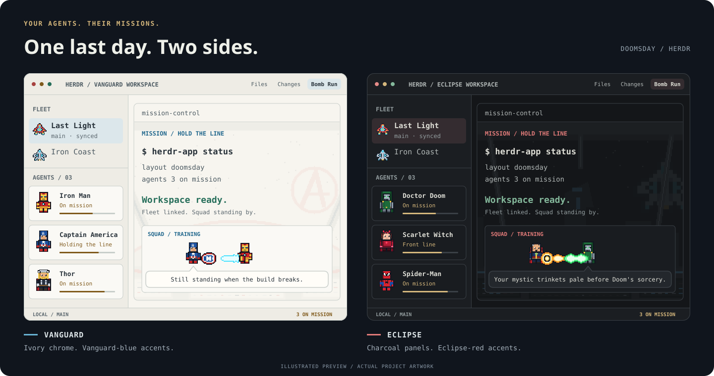
  <br>
  <sub>Illustrated overview using the actual project artwork and theme colors. Not a screenshot.</sub>
</p>

Your agents become the cast. Your spaces get their own ships. Keep real work in view, with a little more end-of-the-world energy around it.

| Track your squad | Fly your fleet | Train between missions |
| --- | --- | --- |
| Character cards, live statuses, model and context details, pinning and sub-agent trees. | Seven ship identities, matching cockpit backgrounds, Git branch and upstream status. | Multi-front battles, custom squads and character conversations in a separate training Arena. |

## Install

You need the [Herdr desktop app](https://herdr.dev) installed, with `herdr-app` available in your shell. From the repository root, run:

```sh
./install.sh
```

The installer backs up replaced Doomsday Heroes files under `backups/doomsday-<timestamp>/`, validates all seven custom mods, then tries to select the layout. It leaves unrelated layouts, mods and settings untouched. The default destination is `~/.config/herdr-app`; set `HERDR_APP_HOME` to use another app home. If Herdr is not running, the files are still installed and you can select the layout from Herdr later.

To return to your previous workspace appearance, switch layouts in Herdr. Keep Herdr's built-in mods installed: this layout uses `workspace-chrome`, `pane`, `files` and `changes`. The top bar is `doomsday-tabs`, a copy of Herdr's `tabs` with a Bomb Run button added.

## Choose your side

One layout, two coordinated appearances:

| Vanguard | Eclipse |
| --- | --- |
| Ivory surfaces, blue accents and warm cockpit lighting. | Charcoal surfaces, muted red accents and darker cockpits. |
| 14 available characters. | The same roster, with King Umbra joining the cast. |

The layout follows system appearance until you select a side. Use **Doomsday Heroes: Vanguard** or **Doomsday Heroes: Eclipse** in the command palette, or run:

```sh
herdr-app do doomsday-systems.light
herdr-app do doomsday-systems.dark
```

These commands change both appearance and palette while preserving unrelated settings. Herdr's `app.theme` command changes the palette only. Return to automatic switching with **Settings → Look → System**.

<details>
<summary>Explore the cockpit artwork</summary>

<table>
  <tr>
    <th>Vanguard · Arrowhawk</th>
    <th>Eclipse · Skyrunner</th>
  </tr>
  <tr>
    <td>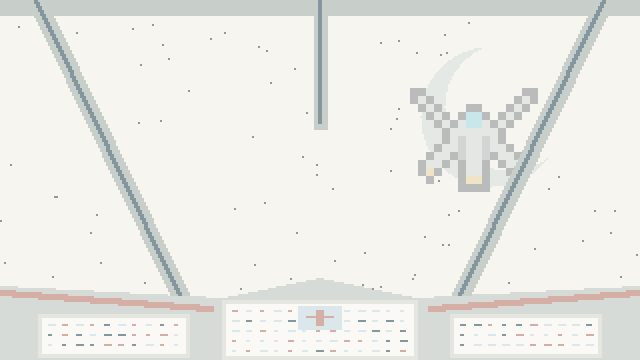</td>
    <td>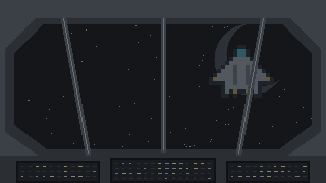</td>
  </tr>
</table>

Every ship has both appearances: **Skyrunner, Arrowhawk, Nightglass, Bastion, Longbow, Dart** and **Eclipse Barge**. Each space keeps a stable ship identity; its cockpit follows that space and the active appearance.

</details>

## The cast

<p align="center">
  
  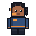
  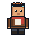
  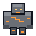
  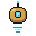
  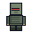
  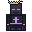
  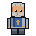
  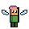
  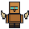
  
  
  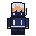
  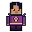
  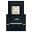
</p>

Meridian, Vesper, Rook, Basalt, Cog, a Husk drone, Aldric, Pip, Kestrel, Juno, Dr. Vale, Nyx, Hexa and Morrow are available in both appearances. Umbra joins on the Eclipse.

Characters stay unique across agents; extra agents receive Husk drones after the other available characters are assigned.

| Agent status | In your workspace |
| --- | --- |
| **Working** | On mission. Long-running work progresses through **Holding the line**, **Front line** and **Last stand**. |
| **Blocked** | Needs backup, with a visible `!` indicator. |
| **Done** | Mission complete, with a completion marker. |
| **Idle** | On standby. |

Pin agents, fold groups, or inspect live sub-agent trees. Cards show model and context details when detected. Character-aware alerts and the status bar highlight agents that need attention.

### Mini battles

Two or more agents in the same space appear over that space's cockpit. Working characters attack, blocked characters hold position, and done characters celebrate. Dialogue alternates between speakers, with pair-specific quotes and status-aware lines.

Each space has its own **Pause** control. Use **Squad** to page through larger groups and **Expand** to open the visible squad in the Arena. Speech bubbles point toward the speaker and keep their own row below the characters, not over their heads.

## Battle Simulator

A separate training scene, with no commands sent to real agents.

1. **Build a matchup.** Choose **Classic**, **Doomsday**, **Strike team** or **Council**, or pick **Custom** and select 2–8 fighters from the full cast. Selection order defines pairs; an odd fighter stays on standby.
2. **Follow the action.** Up to four fronts run at once, with blade clashes, pulse bursts, Pip's jumps, Kestrel's jetpack, Nyx's twin white blades, Hexa's purple blade and Morrow's void bolts. Support characters remain unarmed.
3. **Tune the conversation.** Click a fighter to hear that front; click again to return to squad comms. Use **Next line** to advance or **Replay** to restart the conversation. Current and previous lines appear in separate speech bubbles with speaker portraits, mixing film quotes with original training banter.
4. **Set the pace.** Choose **0.5× / 1× / 2×**, **Pause / Resume**, or **Motion: reduced** to keep comms without moving or pulsing effects. Close with **Close** or Escape.

Open **Doomsday Heroes: Battle Simulator** from the command palette, use **Expand** in a mini battle, or run:

```sh
herdr-app do mod.open --name doomsday-arena
```

Expanded battles keep their source space's cockpit, even when another space is active. Selection and playback settings reset when the overlay is reopened. Native animations stop when not drawn; dialogue pauses with the simulation or when the app window is hidden.

<details>
<summary>See the Arena</summary>

<p align="center">
  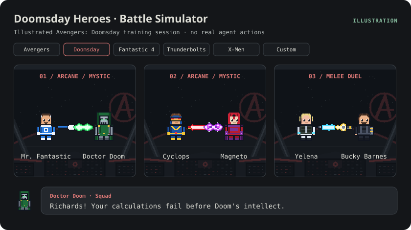
  <br>
  <sub>Illustration built from the project artwork. Not a screenshot.</sub>
</p>

</details>

## Bomb Run

A small Bomberman-style arcade game. Open it from the command palette or from the **Bomb Run** button in the top bar, next to Files and Changes. A second click hides it again. Don't want the game? Run **Doomsday Heroes: Toggle Bomb Run** from the command palette to remove the button (run it again to bring it back); the setting is saved. To open it directly:

```sh
herdr-app do mod.open --name doomsday-bomb-run
```

A dedicated pixel-art deck, with space visible through the forward windows, wall consoles, destructible coolant cells and thermal detonators. A single icon toolbar, inline counters and a small pilot strip use Herdr's theme; the map keeps its own pixel palette. Start, pause and defeat messages appear in a compact lower ribbon rather than covering the center of the arena. The **sliders icon** opens mission options and the upgrade list; on-screen directional controls are optional and hidden by default. Your pilot uses the character assigned to an open agent, with three-pose walking atlases in four directions — no floating avatar or whole-body bounce.

Click **Start mission** or press **Enter** to play. Hold **WASD / arrow keys** to walk, and press **Space** to plant a charge. **P / Escape** pauses; **Enter** resumes; **R** restarts the current deck without losing pilot upgrades. The **×** at the far right of the toolbar always closes the game panel or overlay. Escape from the start, defeat or pause screen also closes it. Switching tabs, leaving the game or hiding Herdr automatically pauses the run. The pilot arrows load another agent's progress; **↗** opens a separate larger game. This is a local training game: it never commands real agents.

**Characters stay unique, including your pilot.** Only Husk drones can repeat. Clearing a deck unlocks **Next deck**. Eight zones now have different solid-wall maps, props, palettes and ship architecture: **Reactor Core, Launch Hangar, Cryo Vault, Smuggler Hold, Ion Engines, Command Bridge, Detention Block and Droid Foundry**. Later sectors revisit these zones with new coolant placements and opposing rosters. Patrols get faster and the squad grows from four to eight hostiles.

**Your agent's pilot evolves through milestones, not loot.** Coolant cells give 5 XP, hostiles 40 XP, and clearing a deck another 75 XP. XP and the highest unlocked deck are saved locally per agent, including after defeat or reopening. Ranks track XP, while combat upgrades require **both** a minimum deck and total XP. There are no floor modules, random drops or stackable buffs.

| Upgrade | Requires | Effect |
| --- | --- | --- |
| **Blast extender** | Deck 2 + 200 XP | 3-tile reach; 4 at deck 5 + 1,200 XP, 5 at deck 8 + 2,200 XP |
| **Extra magazine** | Deck 3 + 600 XP | 2 charges; 3 at deck 8 + 2,200 XP |
| **Line launcher** | Deck 5 + 900 XP | **Q / Line** plants a facing row using available charges, stopping at obstacles |
| **Nova payload** | Deck 6 + 1,400 XP | Optional three-tile-wide blast lanes |
| **Sprint boots** | Deck 7 + 1,800 XP | One speed improvement: 160 → 120 ms per tile (1.33×) |
| **Echo charge** | Deck 8 + 2,400 XP | Optional second explosion after one second, marked by warning beacons |

**E** cycles unlocked payloads: Standard, Nova or Echo. **Nova and Echo cannot be combined.** Range is capped at five tiles, capacity at three charges, and speed has only one upgrade. The upgrade list in Mission options shows locked/unlocked milestones; hover for requirements and effects. Retries keep XP and unlocks, but start with the Standard payload. Consoles still block damage, coolant cells stop a ray after breaking, and planted charges snapshot their payload. Echo never repeats recursively, and a deck cannot finish with pending charges or echoes.

**Optional: Thinking only.** Use the **link icon** in the toolbar, or the descriptive switch in Mission options, to play only while the **selected pilot's agent** reports `working`. Idle, done, blocked, unknown and disconnected agents freeze the entire game: patrols, fuses, echoes, time, XP and gameplay inputs. A waiting screen explains the block. When the agent works again, an already running game continues without resetting or replaying held keys; manual/focus pauses still require Resume. The switch is saved locally, defaults to Off, and never commands the agent.

<details>
<summary>See Bomb Run</summary>

<p align="center">
  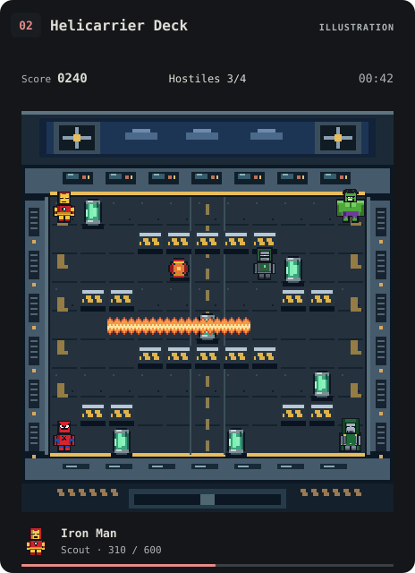
  <br>
  <sub>Illustration built from the game's own pixel art. Not a screenshot.</sub>
</p>

</details>

<details>
<summary>Explore all eight deck layouts</summary>

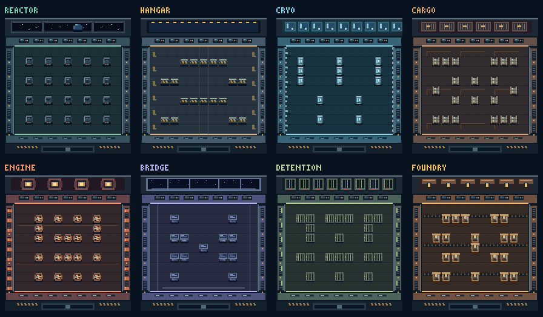

Generated artwork and fixed wall layouts, not an app screenshot. Coolant cells and characters are omitted so each zone’s architecture is visible.

</details>

## Model and context details

Model and context values are inferred from terminal output every 15 seconds, not provided directly by Herdr. If no supported value is found, the card omits it.

<details>
<summary>Supported status-line formats</summary>

- **Claude Code:** `ctx 27%`, a percentage bar, or `Context left until auto-compact: 73%`.
- **pi:** footer formats such as `12.6%/500k` and `(provider) model • medium`.
- **Other agents:** model names such as `gpt-*` and lines like `85% context left`.

Claude Code does not show a status line by default. Configure one to print model and context usage if you want these details on its card.

</details>

## Notifications

In-app alerts work without extra tools. System banners use:

| Platform | Optional system integration |
| --- | --- |
| **macOS** | `terminal-notifier` (`brew install terminal-notifier`). Clicking its banner activates Herdr. |
| **Linux** | `notify-send` from `libnotify`. |
| **Windows** | In-app alerts only. |

Notification permissions may also need to be enabled in the operating system. If the helper is missing or fails, the in-app alert remains the fallback. macOS notifications never fall back to AppleScript, because those banners can open Script Editor instead of Herdr.

## Customize and test

| Change | Edit |
| --- | --- |
| Interface colors and cockpit palettes | `themes/vanguard.json`, `themes/eclipse.json` |
| Character pixels and palettes | `tools/build-sprites.py` |
| Arena presets, character profiles and dialogue | `mods/doomsday-arena/choreography.js` |
| Bomb Run compact chrome and options drawer | `mods/doomsday-bomb-run/ui.js` |
| Bomb Run grid, buffs and game rules | `mods/doomsday-bomb-run/game.js` |
| Bomb Run zone identities and wall maps | `mods/doomsday-bomb-run/decks.js` |
| Bomb Run deck, props, bitmap labels and walking atlases | `tools/build-bomb-run-art.py` |
| Mini-battle dialogue and presentation | `mods/doomsday-agents/battle.js` |
| README illustrations and `preview.png` | `tools/build-readme-art.py` |

Rebuild artwork after changing its source:

```sh
python3 tools/build-sprites.py --preview /tmp/doomsday-sprites.png
python3 tools/build-ship-backgrounds.py --preview /tmp/fleet-backgrounds.png
python3 tools/build-readme-art.py
# preview.png is the overview illustration rendered at 2x, e.g. with headless Chrome:
# chrome --headless=new --force-device-scale-factor=2 --window-size=1440,760 --screenshot=preview.png docs/images/overview.svg
python3 tools/build-bomb-run-art.py --preview docs/images/bomb-run-decks.png
```

The builders use Python's standard library. Run the regression suite with Node's built-in test runner:

```sh
node --test tools/*.test.mjs
```

The tests cover theme contrast, local assets, both battle appearances, custom rosters, dialogue, squad paging, per-space controls, pause, speed and reduced motion. Validate changed mods with `herdr-app check mods/<mod-name>` as well.

For the implementation map, see [Architecture](docs/architecture.md).

## Herdr gallery

This repository is a [Herdr community layout](https://herdr.dev/layouts): the root holds `layouts/doomsday.json`, its `mods/`, the [`RECIPE.md`](RECIPE.md) brief and `preview.png`, and the repo carries the `herdr-layout` topic. `share/doomsday/` is the same package as a self-contained folder; keep it in sync with the root (`tools/docs.test.mjs` checks it).

## Inspiration and credits

Inspired by [Herdr Middle-earth](https://github.com/joaovitorwoliveira/herdr-middle-earth), particularly its character-driven approach to a Herdr workspace. Pixel-art styling was also informed by [King Umbra CSS Pixelart](https://github.com/alexaquino/darth-umbra-css-pixelart).

General Herdr behavior is adapted from the `agents`, `toast`, `workspace-status` and `spaces` mods. Their source lineage is recorded in each mod's `cloned_from` metadata. See [Inspiration and credits](docs/inspiration.md) for more context.

---

Every hero, villain, line of dialogue and piece of artwork in this project is original. It is a personal project and is not affiliated with any film studio or comic publisher.
